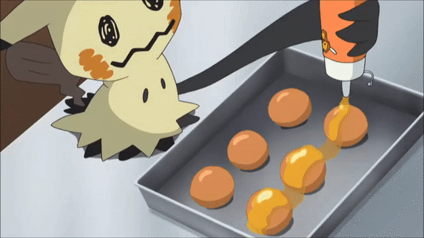

## 🔮 Oi, eu sou a Ana Claudia

Vim da área administrativa (atendimento, e-commerce, rotinas de escritório) e hoje estudo **Análise e Desenvolvimento de Sistemas**. Gosto de entender como as coisas funcionam por trás da tela e de explicar isso de um jeito simples.

## 💜 Em código
- 🔭 Projeto recente: sistema de estoque para loja de equipamentos de computador
- 🌱 Estou aprendendo: Python (curso da Santander Open Academy), SQL e lógica de programação
- 🎓 Já ensinei lógica de programação para iniciantes em um centro comunitário
- 🔧 Curiosidade: já fiz curso de montagem de computadores
- 💬 Pergunte-me sobre: atendimento ao cliente, anúncios em marketplaces e rotinas administrativas

## 🪻 Fora do código

  

- 🕹️ Jogos: Cozy Games, Assassin's Creed, Danganronpa e CoD
- 📺 Série: Criminal Minds
- 🍇 Animes: gosto de assistir
- 🎵 Som: sou eclética, mas curto Pop, PopRock e Musicais
- 📚 Livro preferido: a série Percy Jackson
- 🟣 Gosto de: ler, jogar, estudar e aprender coisas novas

## 📫 Contato
- [LinkedIn](https://linkedin.com/in/anaclaudiaramos) | ac595479@gmail.com
- 💬 [Discord: @lunixvesper](https://discord.com/users/377055967357173760)
- 😄 Pronomes: ela/dela

  

